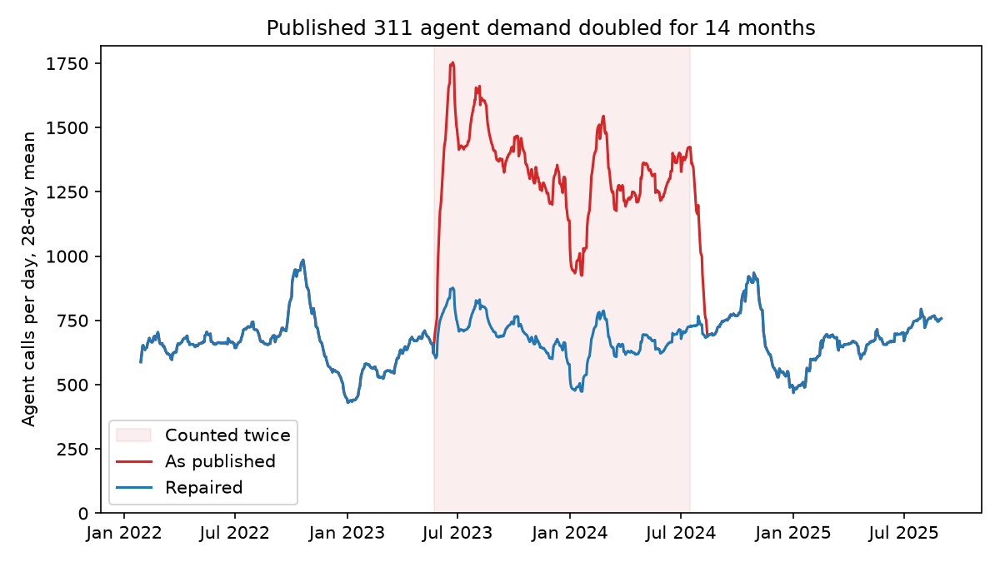
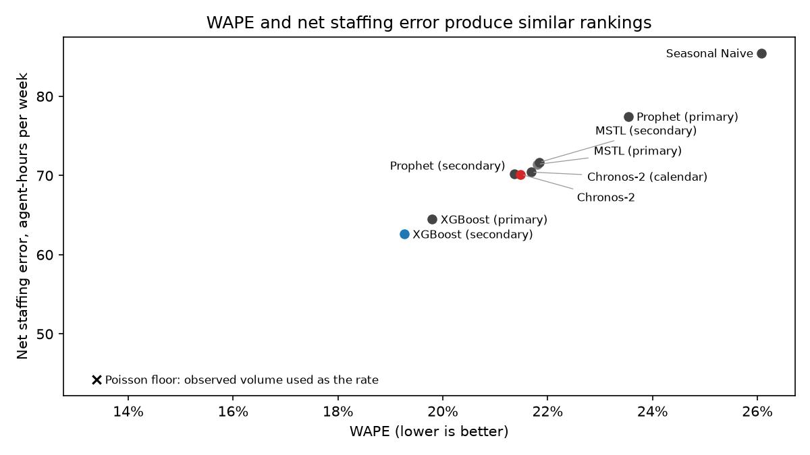
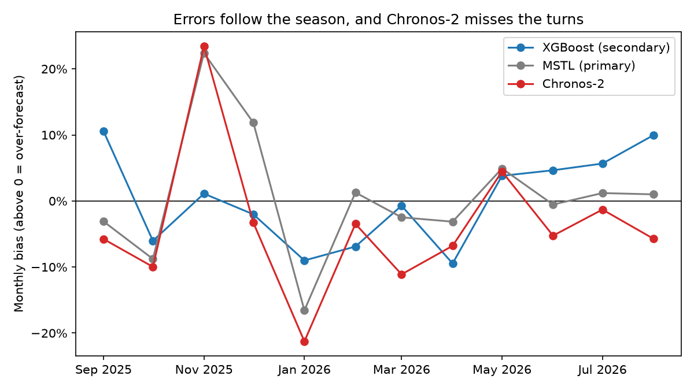
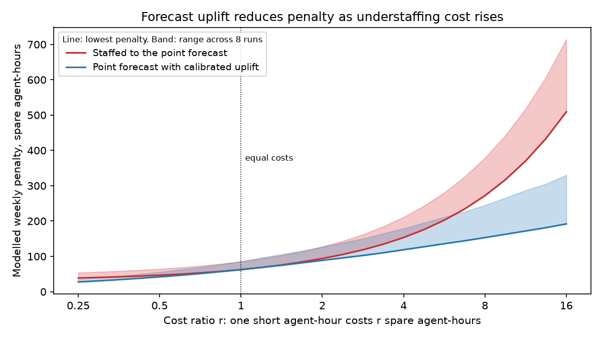
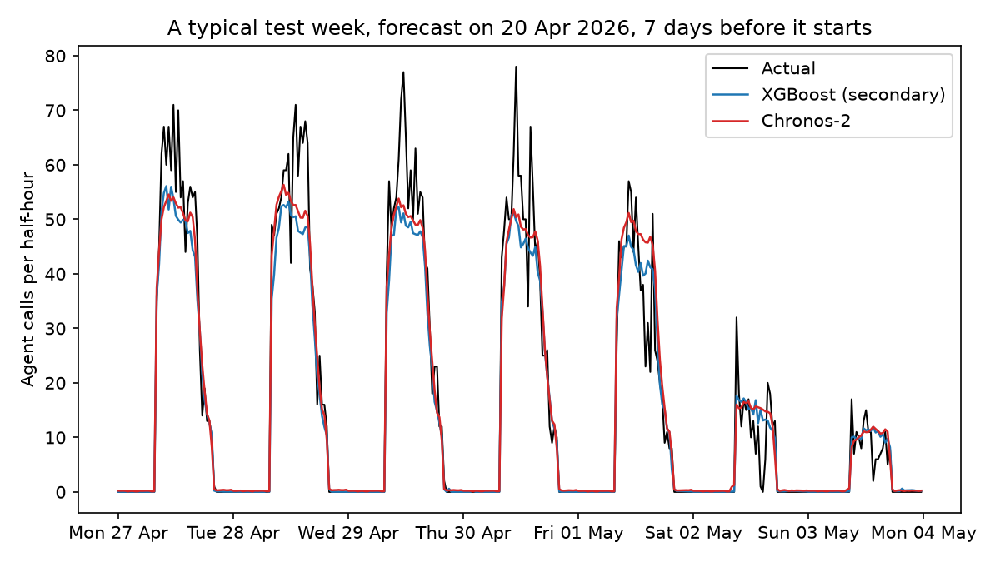

# Contact-Centre Forecasting and Staffing: A Halifax 311 Case Study

Does the most accurate forecast give the best staffing? This project tests eight forecasts of contact-centre demand by the staffing decision they cause, not only by their error. The data is Halifax Regional Municipality's half-hourly 311 call volume. Each Monday, every model forecasts the week that starts seven days later, the horizon at which a schedule is built. Each forecast then goes through an Erlang A model to give the agents needed per half-hour, and is compared with the agents that actual demand needed. The test is 52 weeks, September 2025 to August 2026.

**Terms used below**

- **WAPE**: total absolute forecast error divided by total actual calls.
- **Staffing error**: the gap between the productive agents a forecast asks for and the productive agents actual demand needed, in agent-hours per week. One agent for one half-hour is 0.5 agent-hours. It is an error, not the hours the centre works.
- **Cost ratio r**: how many spare agent-hours one short agent-hour costs. At r = 1 both cost the same.
- **Primary and secondary**: models trained on the data after the July 2024 platform change only, or on all data from 2017.
- **Scenarios**: the staffing inputs changed one at a time: service target, caller patience, handle time, and Erlang C in place of Erlang A.

## Findings

**1. The published data was wrong, by 61% for one year.** From May 2023 to July 2024 most days are counted twice, and from July 2024 every timestamp has a fixed UTC+4 offset. HRM does not document either defect. A model trained on the series as published learns a demand level that never happened. Both defects are repaired before any model is built (see [Data](#data)).



**2. At this volume, WAPE is enough to choose a model for staffing.** Staffed from the point forecast with symmetric costs, the WAPE ranking and the staffing-error ranking agree, with a rank correlation of 0.95–1.00 in all six staffing scenarios. XGBoost is best, and every model that is not XGBoost is worse by an interval that excludes zero (paired weekly differences, moving-block bootstrap with 4-week blocks). The reason is the noise floor. At about 32 calls per open half-hour, a forecast that knew the true rate would still have 13.4% WAPE and 44 agent-hours of error a week if calls were Poisson. The best model has 19.3% and 63. The models differ only in what is left above the floor.



**3. WAPE hides the direction of error, and the direction matters when understaffing costs more.** Chronos-2 and Prophet (secondary) have the same staffing error, but Chronos-2 under-forecasts by 4.4%. It understaffs 37% of intervals against 29%, and Erlang A expects its agents to answer 78.4% of calls in 25 s, below the 80% target. Staffed from the point forecast at a cost ratio of 16, Chronos-2 falls from third to seventh. Its errors also follow the season: like MSTL, it tracks the recent level and misses the turns, over-forecasting November by 23% and under-forecasting January by 21%.



**4. Under asymmetric cost, a buffer pays as much as a better model, then more.** The buffer is one uplift on the point forecast: the q-quantile of actual / forecast, fitted on forecast errors inside training, with q = r / (1 + r). When an understaffed agent-hour costs four times a spare one, the buffer lowers each model's cost by 15–31%, and the best weekly cost falls from 153 to 119. Among the non-naive models with a buffer, the best model saves up to 23% against the worst. At eight times, the buffer saves 35–51%, and the model choice still about 26%. The uplift is fitted to each model's own errors, so it also offsets bias, and Chronos-2 gains the most. A separate quantile for each slot type adds less than 1%.



These results are for one test year, one aggregate queue at this volume, a one-week lead and linear costs. A smaller queue or a model with a larger bias can change them. Over the year the 80% quantile covers 76–82% of actual demand, but only 51–81% in January to March, which the calibration weeks (February to August) do not include.

## Results

| Run | WAPE | Bias | Agent-hours error / week | Difference from best | Understaffed | Modelled service level |
|---|---:|---:|---:|---:|---:|---:|
| XGBoost (secondary) | 19.3% | −0.0% | 62.6 | best | 29.6% | 80.6% |
| XGBoost (primary) | 19.8% | +1.5% | 64.5 | +1.8 (−0.2 to +4.3) | 27.9% | 81.5% |
| Prophet (secondary) | 21.3% | +0.9% | 70.2 | +7.6 (+4.3 to +12.6) | 28.6% | 80.3% |
| Chronos-2, zero-shot | 21.5% | −4.4% | 70.2 | +7.5 (+3.6 to +14.0) | 37.1% | 78.4% |
| MSTL (primary) | 21.8% | −0.0% | 71.4 | +8.8 (+5.4 to +14.6) | 32.3% | 80.2% |
| MSTL (secondary) | 21.8% | −0.1% | 71.7 | +9.0 (+5.7 to +14.8) | 32.6% | 80.2% |
| Prophet (primary) | 23.5% | −1.0% | 77.5 | +14.8 (+8.3 to +24.2) | 32.9% | 79.1% |
| Seasonal Naive | 26.1% | +0.5% | 85.5 | +22.8 (+19.3 to +28.0) | 34.8% | 79.5% |
| Poisson oracle floor | 13.4% | | 44.2 | | | |

Point staffing, primary scenario, open intervals. The difference from best is the mean weekly difference in agent-hours error, with a 95% moving-block bootstrap interval; an interval that contains zero does not separate the runs. Modelled service level is the share of actual calls that Erlang A expects the staffed agents to answer in 25 s. It is not a measured service level.

A warm Chronos-2 forecast takes 0.3 s, against 1–2.5 s for XGBoost and 15–90 s for MSTL and Prophet, so run cost does not decide between these models at this scale.

This is what a typical week looks like: the test week of median XGBoost WAPE.



[baselines.md](results/baselines.md) has accuracy at peak, off-peak and after closures, and run cost. [decision.md](results/decision.md) has the bootstrap intervals, the cost-ratio sweep, quantile calibration and the scenarios.

## Data

The data is HRM's open [311 Call Volumes](https://services2.arcgis.com/11XBiaBYA9Ep0yNJ/arcgis/rest/services/311_Call_Volumes/FeatureServer/0) service, half-hourly from 2017. `src/ingest.py` pulls it. The target is agent demand: `HANDLED + ABANDONED` per half-hour. `OFFERED` also counts calls that end in the IVR, and runs about 48% higher. Agents work weekdays 08:00–20:00 and weekends 09:00–17:30, and statutory holidays are closed. Forecasts are scored and staffed on open intervals only.

| Defect | How it shows | Evidence | Repair |
|---|---|---|---|
| From 2024-07-17, each interval is a fixed UTC+4 timestamp | The weekday peak moves to the late afternoon, and Saturday 01:00 carries Friday-evening calls | Read as UTC+4, the profile matches the pre-2023 profile at correlation 0.9997, against 0.96–0.97 at ±30 minutes | Convert the labels to Halifax local time |
| From 2023-05-23 to 2024-07-16, most days are counted twice | Agent demand doubles overnight and halves fourteen months later | On 395 of 407 days every count is even. On each of those days, published calls are 2.00–2.03 times the distinct call IDs in HRM's per-call dataset | Halve the doubled days. Repaired calls are within 1.3% of the distinct call IDs on every halved day, and equal on 379 of 395 ([duplicate_check.csv](results/duplicate_check.csv)) |

The repaired FY2023/24 volume matches HRM's published figure within 5%. [data_audit.md](data/raw/data_audit.md) has the full evidence. 2024-07-17 is also a platform cutover, after which abandonment is lower, so models train on two windows:

| Window | Dates |
|---|---|
| Primary training | 2024-07-17 → 2025-08-31 |
| Secondary training | 2017-07-03 → 2025-08-31 |
| Test | 2025-09-01 → 2026-08-31 |

## Method

**Forecasts.** Each model stands for one approach a planning team can use: Seasonal Naive is the floor that any model must beat; MSTL and Prophet are statistical decomposition; XGBoost is machine learning on calendar and lag features; Chronos-2 is a pretrained foundation model with no training on this series. XGBoost forecasts every slot from the calendar and from the same slot 2–5 and 52 weeks earlier; no lag is shorter than the 14 days from the origin to the end of the target week. Chronos-2 forecasts zero-shot from the last 24 weeks, its maximum context. Closed days in the history are replaced by the last open day of the same weekday. No setting is tuned on the test window.

**Staffing.** Each forecast gives the integer agent requirement per open half-hour. Staffing error is the gap to the requirement of actual demand, in agent-hours. Cost is r × short + over, with the cost ratio r swept from 0.25 to 16. Before any model was built, a probe showed that 10% WAPE changes the requirement in 39% of open half-hours ([staffing_probe.md](results/staffing_probe.md)).

**Assumptions.** Halifax publishes call counts, not rosters, so the requirements are counterfactual, and no figure is a claim about HRM costs. The unit is the productive requirement per half-hour; breaks, shrinkage, shifts, headcount and FTE are out of scope.

- **Erlang A, with Erlang C as comparator.** The data records abandoned calls, and Erlang C assumes none.
- **80% in 25 s**, from HRM documents (2010–2014); 75% in 25 s (2017–2019) is a scenario. No later target is published.
- **Service time 237 s**, mean talk time in primary training, swept to 360 s. Whether hold and after-call work are included is not published, so it is a lower bound on handle time.
- **Patience 120 s**, swept from 60 to 300 s. Without waiting times the data cannot identify it.
- **Each half-hour is sized on its own**, as steady state with Poisson arrivals. Real arrivals vary more: same-slot demand in adjacent weeks varies about 1.9 times as much as Poisson allows, so the true noise floor is higher than the oracle floor. Surges inside a half-hour are not visible in the data and are not modelled, so the model-implied service level is likely higher than a real centre would record.

## Contamination audit

Chronos-2 is a pretrained model, so the test could be leaked through its training data.

- **Source.** HRM's ArcGIS `311_Call_Volumes` service, pulled 2026-09-13 16:13 UTC, 148,269 rows. `src/ingest.py` records the query and the pull time with each snapshot.
- **Test window.** Frozen before any model was built. No test data was uploaded to any training or fine-tuning service.
- **Pretraining corpus.** Chronos-2 was released in October 2025. Halifax 311 is not in its published training data. Most test weeks are after its release.
- **Exact series against domain.** No evidence that the exact series was seen. The model has seen other call and demand series, which is the domain knowledge a zero-shot model is meant to bring.
- **Residual uncertainty.** A disclosed corpus cannot prove that a public series was never seen. This is an external zero-shot evaluation under disclosed-pretraining uncertainty.

The other models train only on the training windows.

## Related work

Bastianin, Galeotti and Manera (2019) evaluate daily call-arrival forecasts both statistically and by the cost of Erlang C staffing at 80/20. Both evaluations select the same best models, but the MSE ranking differs from the cost ranking, and only the cost ranking separates the two best. Ding and Koole (2022) show, under their cost model, that optimal staffing is a quantile of the forecast and that staffing cost is close to linear in absolute forecast error, which supports WAPE under symmetric costs. This project asks the same question on half-hourly data at the schedule horizon, with Erlang A and machine-learning and foundation models. To our knowledge, no published study uses the Halifax data.

## Run it

The project uses [uv](https://docs.astral.sh/uv/) and Python 3.11–3.12.

```sh
uv sync
uv run python -m src.ingest     # pull a dated snapshot into data/raw/
uv run python -m src.clean      # write data/processed/series.parquet
uv run python -m src.duplicates # check the duplicate repair against per-call records
uv run python -m src.probe      # write results/staffing_probe.md
uv run python -m src.evaluate   # backtest every model, about 4 hours on an Apple M2
uv run python -m src.decide     # staff every forecast, about 1.5 hours the first time
uv run python -m src.report     # draw results/figures/
uv run pytest                   # add -m 'not network' to skip the Chronos-2 download
```

Snapshots, processed data and most results are not committed. The snapshot tests fail until a snapshot exists. A pull refuses to replace a snapshot from the same UTC date.

## Repository

```text
src/ingest.py          ArcGIS pull and snapshot checks
src/clean.py           time-base and duplicate repair, regular series, windows
src/duplicates.py      day-by-day check of the duplicate repair
src/erlang.py          Erlang B, C and A; required agents
src/probe.py           staffing sensitivity probe
src/baselines.py       Seasonal Naive, MSTL, Prophet, XGBoost, Chronos-2
src/evaluate.py        weekly backtest and metrics
src/decide.py          staffing from forecasts, cost-ratio sweep
src/report.py          README figures
data/special_days.csv  closed days, named events, source transitions
notebooks/01_eda.ipynb seasonality and source breaks
```
